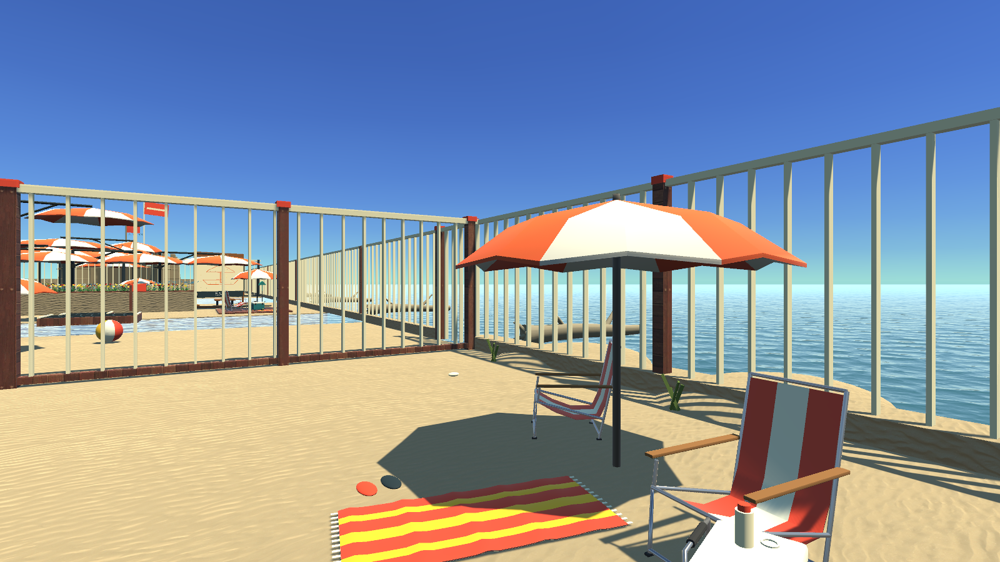
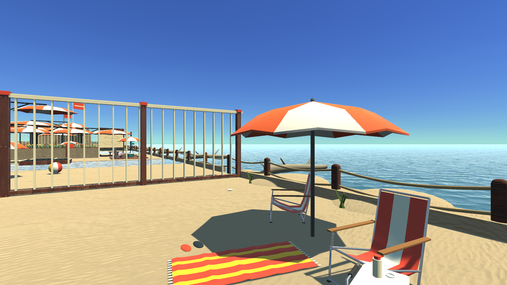

# feat(beach): 해변 외곽을 낮은 목재 로프 난간으로 개선

높은 세로 철창에 가려지던 해변 외곽을 낮은 목재 말뚝과 두 줄 로프로 바꿔 바다와 수평선이 보이도록 했습니다.

- 외곽 세 방향의 높은 난간 시각 요소 570개를 숨기고, 풍화 목재·천 로프·금속 고정구로 교체합니다.
- 기존 월드 경계 충돌체와 두 퍼즐 게이트는 유지해 외곽 이탈과 진행 순서 우회를 방지합니다.
- 새 난간 장식에는 충돌체나 퍼즐 그늘을 추가하지 않습니다. 숨긴 철창도 보이지 않는 안전 그늘을 만들지 않습니다.
- 해당 난간만 바뀐 저장 씬과 재생성 코드를 포함합니다.

## 비교 이미지

1600×900 원본 PNG를 사용했습니다. 비포는 소품 개선 전, 애프터는 여섯 변경을 합친 실제 Unity Play Mode 화면입니다. 애프터 배경의 다른 소품 개선은 이 PR의 단독 변경 범위에 포함되지 않습니다. 생성형 구상안이나 보정 이미지는 사용하지 않았습니다.

| 비포 | 애프터 |
| --- | --- |
|  |  |

## 검증

통합 씬의 입구 검증 5/5: 닫힌 게이트를 점프로 넘지 못하고 정상 개방 후 통과하는 것을 확인했습니다. 생성기에서도 경계 충돌체 보존과 새 장식의 그늘 미생성을 검사합니다. 구현 당시 실제 실행 기록은 [native-validation.json](native-validation.json), 사진 해시와 검증 범위는 [verification.json](verification.json)에 보관했습니다.

이번 PR 발행에서는 게임 코드를 수정하지 않고 사진·설명·실행 기록을 추가했습니다. 소스 diff 검사, 원본 PNG 확인과 통합 씬 해시 대조를 수행했습니다. 새 실행 파일 빌드·전 구간 수동 클리어·GPU 성능 측정은 반복하지 않았습니다.

## 기준과 병합

기존 에셋 PR들이 아직 main에 병합되지 않아, 개발 당시 로컬 main인 `caed3560b83411ada740bebaa9eebf0100ea223c`를 `codex/beach-coastal-base`로 올려 이 PR의 기준으로 사용합니다. 원격 main에는 병합하지 않았습니다. 이 기준에는 앞서 작업한 물·모래·목재·꽃·C 파라솔과 원형 기단이 포함됩니다.

기존 에셋 변경이 main에 반영되면 기준 브랜치 차이도 반영한 뒤 base를 main으로 전환해야 합니다. 여러 소품 PR의 저장 씬이 충돌하면 생성 코드를 모두 반영한 후 Unity 메뉴 `Parallax/마지막 해변 씬 준비`로 씬을 재생성합니다.
