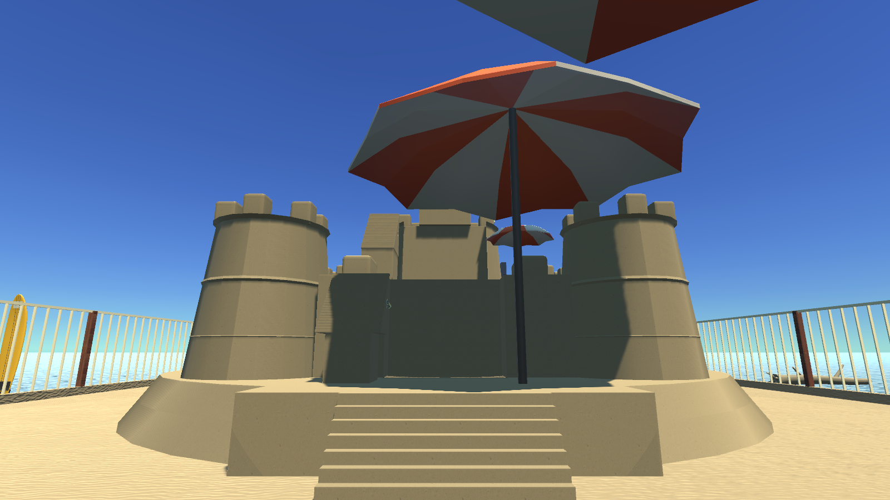
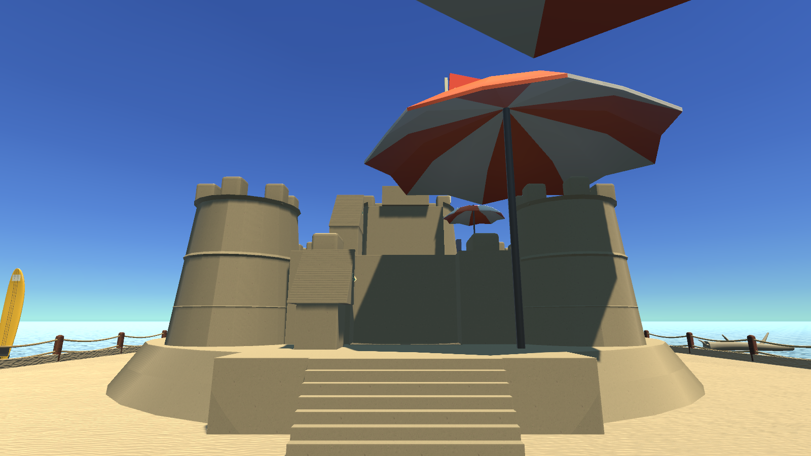

# fix(beach): C 파라솔 위치를 조정해 모래성 정면 시야 확보

모래성 정면과 깃발을 가리던 입구 고정 파라솔을 오른쪽으로 옮겼습니다. 선택한 C / ToonTastic 파라솔의 모델·재질·크기는 유지하고, 첫 계단에 필요한 실제 그늘을 남겼습니다.

- 고정 파라솔 위치를 (1.4, 1.1, 88.65)에서 (2.4, 1.1, 89.05)로 조정합니다.
- 이동형 파라솔과 다른 차양의 모델·재질·크기, 햇빛 방향과 퍼즐 판정은 변경하지 않습니다.
- 저장 씬과 생성 시 사용하는 배치 값을 함께 반영합니다. 임시 자동 플레이 좌표 수정은 포함하지 않습니다.

## 비교 이미지

1600×900 원본 PNG를 사용했습니다. 비포는 소품 개선 전, 애프터는 여섯 변경을 합친 실제 Unity Play Mode 화면입니다. 애프터 배경의 다른 소품 개선은 이 PR의 단독 변경 범위에 포함되지 않습니다. 생성형 구상안이나 보정 이미지는 사용하지 않았습니다.

| 비포 | 애프터 |
| --- | --- |
|  |  |

## 검증

통합 씬에서 세 가지 준비된 계단 배치를 실제 물리로 안착시킨 뒤 캐릭터 컨트롤러로 정상에 도달하는 검증 3/3을 통과했습니다. 구현 당시 실제 실행 기록은 [native-validation.json](native-validation.json), 사진 해시와 검증 범위는 [verification.json](verification.json)에 보관했습니다.

이번 PR 발행에서는 게임 코드를 수정하지 않고 사진·설명·실행 기록을 추가했습니다. 소스 diff 검사, 원본 PNG 확인과 통합 씬 해시 대조를 수행했습니다. 새 실행 파일 빌드·전 구간 수동 클리어·GPU 성능 측정은 반복하지 않았습니다.

기존 전체 자동 집기·배치 스크립트는 변경 전 C 차양에서도 집기 좌표가 차양 충돌체 안으로 들어가 실패합니다. 이 실패를 숨기거나 통과로 세지 않았으며, 해당 테스트 좌표 수정은 되돌렸습니다. 준비 배치 검증은 처음 물체 배치를 지정하므로 전체 수동 클리어를 증명하지 않습니다.

## 기준과 병합

기존 에셋 PR들이 아직 main에 병합되지 않아, 개발 당시 로컬 main인 `caed3560b83411ada740bebaa9eebf0100ea223c`를 `codex/beach-coastal-base`로 올려 이 PR의 기준으로 사용합니다. 원격 main에는 병합하지 않았습니다. 이 기준에는 앞서 작업한 물·모래·목재·꽃·C 파라솔과 원형 기단이 포함됩니다.

기존 에셋 변경이 main에 반영되면 기준 브랜치 차이도 반영한 뒤 base를 main으로 전환해야 합니다. 여러 소품 PR의 저장 씬이 충돌하면 생성 코드를 모두 반영한 후 Unity 메뉴 `Parallax/마지막 해변 씬 준비`로 씬을 재생성합니다.
