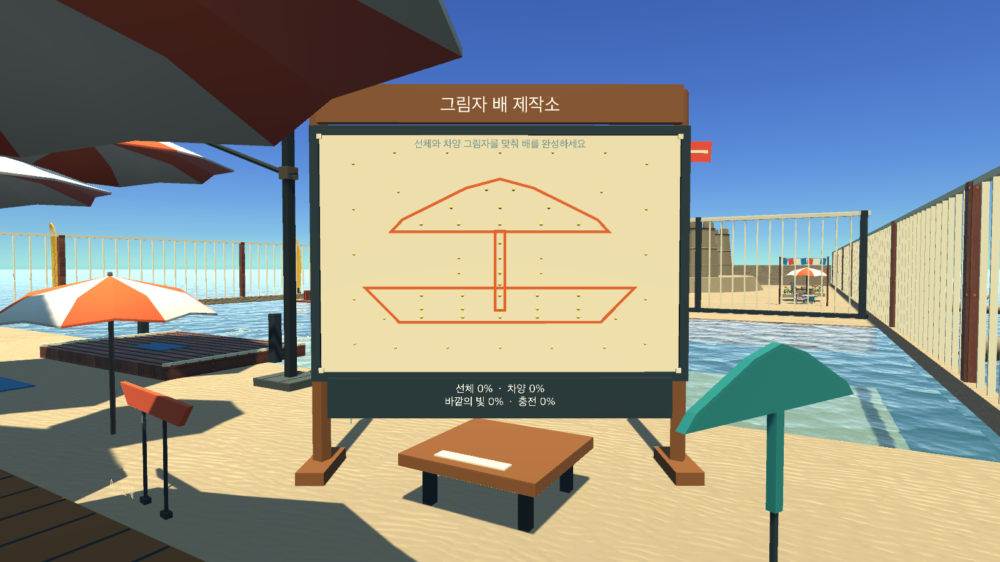
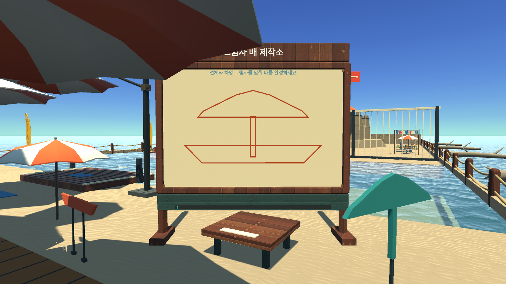
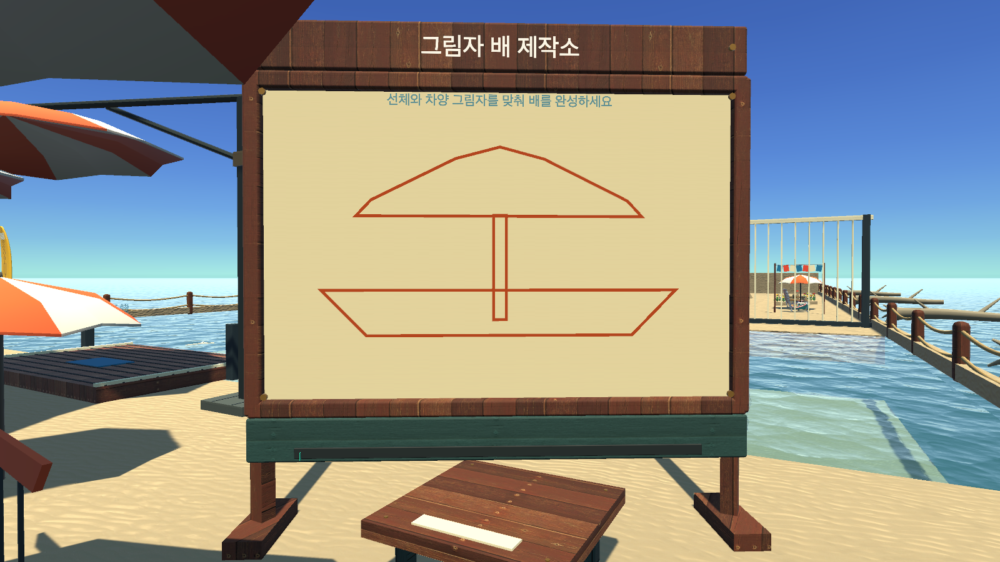

# feat(beach): 그림자 제작 보드를 목재 공방 게시판으로 개선

작은 판정 점과 수치가 드러나던 제작 보드를 목재 틀·캔버스·인쇄 도안이 있는 해변 공방 게시판으로 정리했습니다. 배 그림자 윤곽과 진행 막대를 중심으로 읽을 수 있습니다.

- 풍화 목재 프레임, 황동 고정구와 받침 탁자를 적용하고 제목을 굵게 표시합니다.
- 판정 표본의 점 표시는 숨기되 좌표·개수·그림자 판정은 보존합니다. 기존 충전 상태는 얇은 진행 막대로 표시합니다.
- 캔버스와 장식이 스스로 목표를 가리는 그늘을 만들지 않도록 했습니다. 표본과 물리 받침 보존도 생성 시 검사합니다.
- 기존 오른쪽 쉼터를 0.4m 전진해 배 수령 지점의 실제 C 차양 그늘 틈을 보완했습니다. 새 게시판에서 발생하는 표본 그늘은 0개입니다.
- 해당 제작소만 바뀐 저장 씬을 포함합니다.

## 비교 이미지

1600×900 원본 PNG를 사용했습니다. 비포는 소품 개선 전, 애프터는 여섯 변경을 합친 실제 Unity Play Mode 화면입니다. 애프터 배경의 다른 소품 개선은 이 PR의 단독 변경 범위에 포함되지 않습니다. 생성형 구상안이나 보정 이미지는 사용하지 않았습니다.

| 비포 | 애프터 |
| --- | --- |
|  |  |

제목이 온전히 보이는 작업대 접근 시점입니다. 위 비교와 카메라 위치가 다릅니다.

## 검증

통합 씬의 제작소 검증 7/7: 실제 이동과 두 조각의 집기·원근 확대/축소, 배 제작과 수령 동작을 확인했습니다. 구현 당시 실제 실행 기록은 [native-validation.json](native-validation.json), 사진 해시와 검증 범위는 [verification.json](verification.json)에 보관했습니다.

이번 PR 발행에서는 게임 코드를 수정하지 않고 사진·설명·실행 기록을 추가했습니다. 소스 diff 검사, 원본 PNG 확인과 통합 씬 해시 대조를 수행했습니다. 새 실행 파일 빌드·전 구간 수동 클리어·GPU 성능 측정은 반복하지 않았습니다.

## 기준과 병합

기존 에셋 PR들이 아직 main에 병합되지 않아, 개발 당시 로컬 main인 `caed3560b83411ada740bebaa9eebf0100ea223c`를 `codex/beach-coastal-base`로 올려 이 PR의 기준으로 사용합니다. 원격 main에는 병합하지 않았습니다. 이 기준에는 앞서 작업한 물·모래·목재·꽃·C 파라솔과 원형 기단이 포함됩니다.

기존 에셋 변경이 main에 반영되면 기준 브랜치 차이도 반영한 뒤 base를 main으로 전환해야 합니다. 여러 소품 PR의 저장 씬이 충돌하면 생성 코드를 모두 반영한 후 Unity 메뉴 `Parallax/마지막 해변 씬 준비`로 씬을 재생성합니다.
