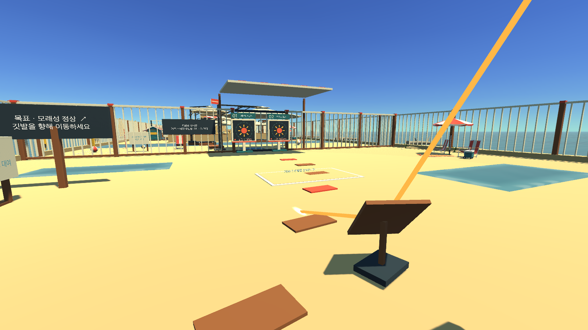
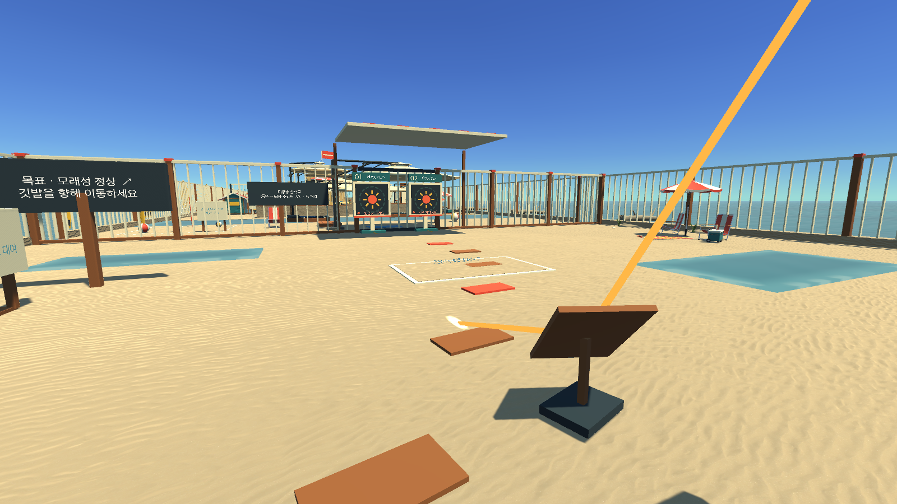
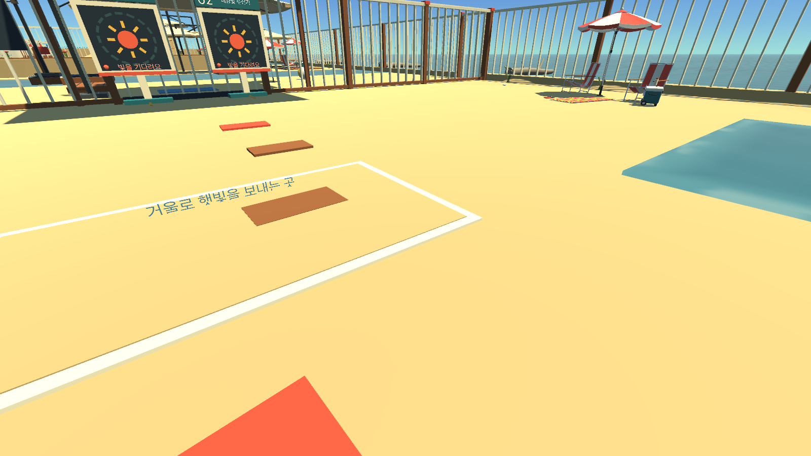
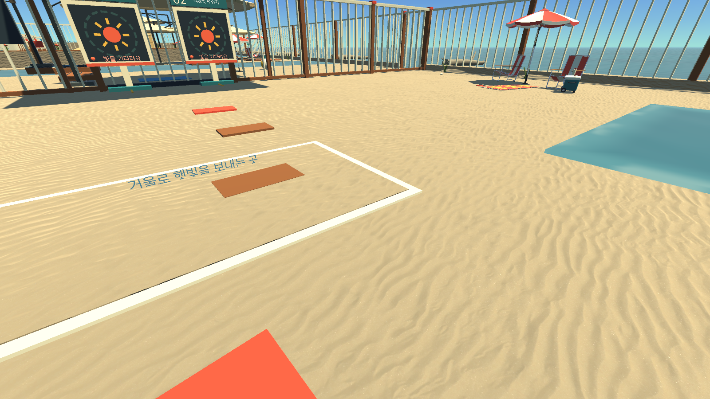

# 해변 모래 재질 적용 전후

기존 단색 바닥을 Yughues Free Sand Materials 1.1의 Sand01 표면으로 변경했습니다.
원본의 1024×1024 노멀·반사/매끄러움 맵과 재질 기본색을 사용합니다.
무늬는 약 2.86m마다 반복되며, 바닥 조각 크기에 따라 늘어나지 않습니다.

## 스크린샷

Unity 6000.3.24f1의 실제 Beach 씬을 Play Mode로 실행하고, 같은 카메라 위치·시야·조명에서
재질 교체 전후를 1600×900 PNG로 저장했습니다. 카메라 출력이라 HUD는 없으며,
이미지 생성·합성·별도 색 보정을 하지 않았습니다.

| 시점 | 적용 전 | 적용 후 |
| --- | --- | --- |
| 입구에서 본 바닥 |  |  |
| 가까이 본 모래 |  |  |

## 확인

- 모래와 기존 해변 셰이더가 모두 오류 없이 컴파일됐습니다.
- 원본 텍스처 해시, 1024 해상도, 노멀 맵 설정, 반복·밉맵·이방성 필터링을 확인했습니다.
- 저장된 모래 재질을 공유하는 표면 28개에 적용됐습니다.
- 기존 배치 그늘 미리보기의 계산은 그대로 재사용합니다.
- Beach 씬 파일 해시가 이전과 같아, 지형·충돌·물체 배치가 보존됐습니다.

[검증 기록](verification.json) · [에셋 출처와 원본 해시](../../projects/all-stages/Assets/ThirdParty/YughuesFreeSandMaterials/source.json)

직접 확인하려면 `projects/all-stages`의 `Assets/Parallax/Beach/Scenes/Beach.unity`를 열고
Play를 누른 뒤 입구에서 바닥을 내려다보면 됩니다. 씬을 다시 생성하는 경로에도 같은
재질 설정을 반영했습니다. 실행 파일 재빌드와 전체 네 구역의 플레이 검증은 수행하지 않았습니다.
