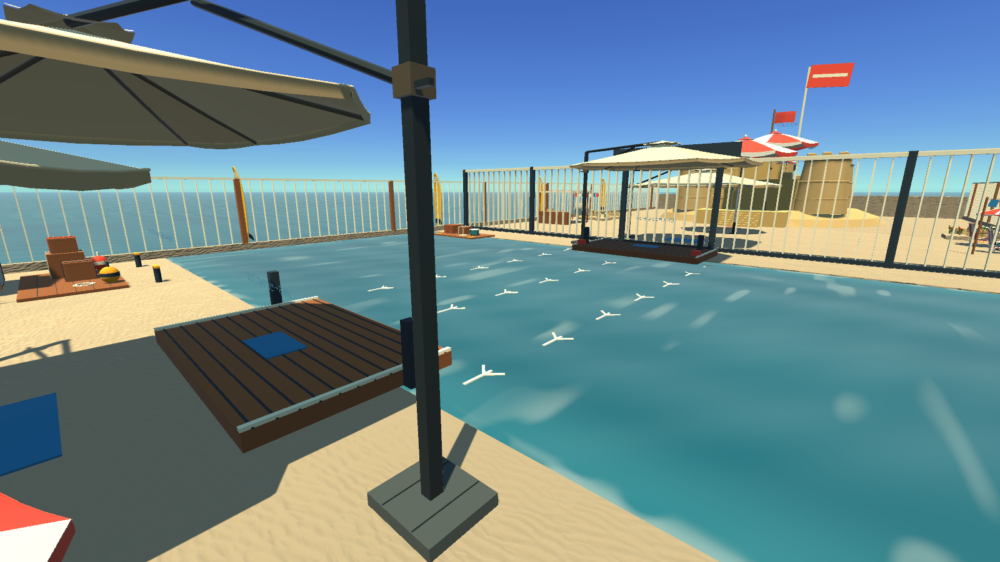
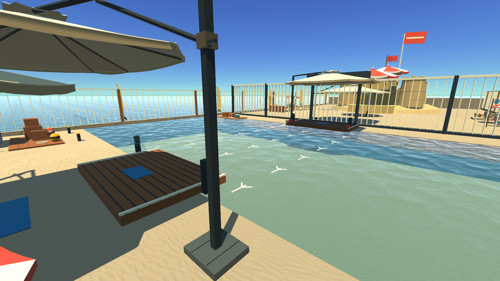
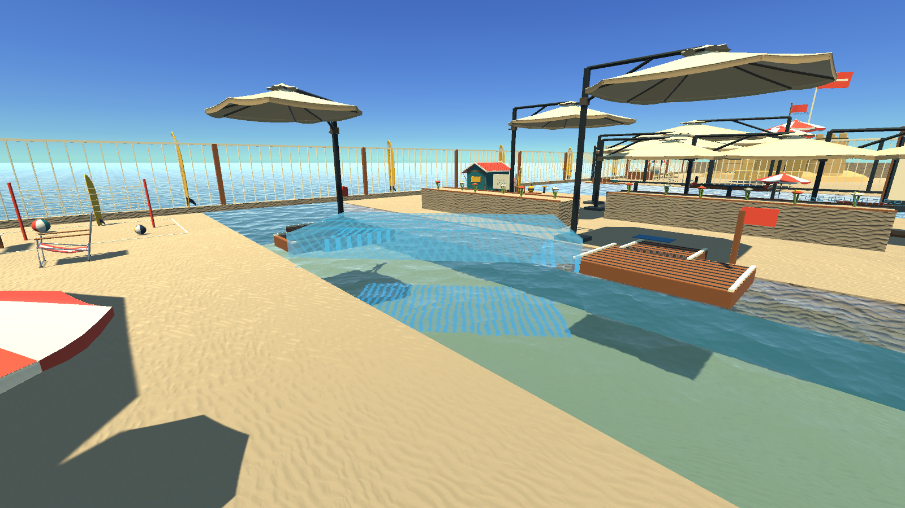
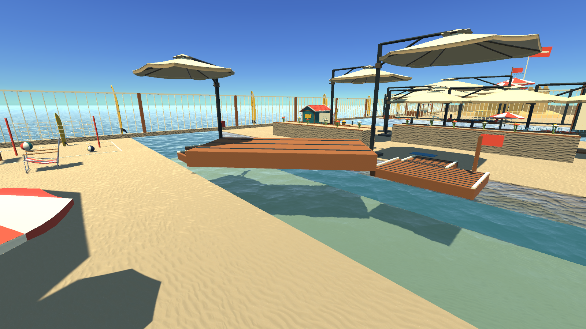

# 해변 수면과 대각선 판자 변경 검토

수면을 Simple Water Shader URP의 원본 텍스처·메시를 활용한 Built-in 표현으로 바꾸고,
사용자가 선택한 B 청록색을 적용했습니다. 두 섬에 걸친 대각선 판자가 반투명 상태로
남아 발판이 되지 않던 문제도 수정했습니다.

## 실제 게임 비포 / 애프터

Unity 6000.3.24f1 / macOS의 저장된 Beach 씬을 Play Mode로 실행한 1600×900 원본 PNG입니다.
물 비교의 비포는 에셋 교체 전 최초 수면이며, 중간 투명 버전은 제외했습니다.
각 행의 카메라 위치·시야·조명은 동일합니다. 생성 이미지, 합성, 별도 색 보정은 사용하지 않았고,
게임 카메라 출력이므로 HUD는 포함하지 않습니다.

| 비교 | 비포 | 애프터 |
| --- | --- | --- |
| 물 에셋과 최종 표현 |  |  |
| 같은 대각선 판자의 발판 판정 |  |  |

판자 비교는 최종 B 수면을 양쪽에 유지하고 지지 판정 코드만 이전/수정 후로 바꿨습니다.
판자 위치는 (-0.25, 0.302, 36.25), 크기 2.8배, Y 회전 48도이며 실제 중력으로 안착시켰습니다.
이전 코드는 양쪽 섬에 걸쳐 정지한 판자를 미설치로 판정했고 플레이어가 통과했습니다.
수정 후에는 원래 재질과 그림자·플레이어 충돌이 복구되고 실제 캐릭터가 위에 섰습니다.

비교 이미지의 모래 재질은 별도 모래 작업 상태로 동일하게 유지했습니다.
이번 PR에는 모래 리소스와 재질 변경이 들어가지 않으며, 수면과 판자 수정은 독립적으로 적용됩니다.

## 확인한 내용

- 신규 수면 셰이더가 정상 컴파일되고 다섯 수면에 B 기본 설정이 적용됩니다.
- 얕은 물에서는 모래가 보이고, 깊어지면 따뜻한 모래색이 감쇠되며 청록빛이 더해집니다.
  확정 B 미리보기와 동일 카메라에서 비교한 평균 RGB 픽셀 차이는 0입니다.
- 일반 수면 네 곳은 정지하고, 배 항로 한 곳만 +Z 방향으로 0.12 m/s로 움직입니다.
  원래 부력·배 이동 속도·물 위험 구역·지형 충돌은 유지합니다.
- `ShadeLink.Editor.PlacementSupportTests.Run`에서 대각선 안착, 실제 캐릭터 올라서기,
  원래 재질·충돌 복구, 재잡기, 연속 안착 시간, 받침 제거, 벽·천장 접촉 제외를 확인했습니다.
  원래 코드에서 재현 테스트가 실패하고 수정 후 통과하는 것을 확인했습니다.
- 저장된 실제 Beach 씬에서도 수정 전 통과/수정 후 올라서기를 각각 확인하고 촬영했습니다.
- 변경된 수면·판자 소스와 동일한 해변 테스트용 macOS 실행 파일 빌드가 성공했습니다.
- 햇빛 방향, 물체 배치와 씬 파일은 변경하지 않았습니다.

공통 지지 판정의 박스형 물체에 적용되는 수정이며, 박스가 아닌 물체의 기존 검사 경로는 유지합니다.
전체 네 구역 완주, 다른 맵 전체 플레이, GPU 성능 측정은 반복하지 않았습니다.

[검증 기록](verification.json) · [물 에셋 출처와 원본 해시](../../projects/all-stages/Assets/ThirdParty/SimpleWaterShaderURP/source.json)

## 다시 확인하기

- `projects/all-stages`를 Unity 6000.3.24f1에서 열고 Beach 씬을 Play Mode로 실행합니다.
- 두 섬 사이에 판자를 대각선으로 걸쳐 놓고 안착 후 불투명한 재질로 돌아오는지,
  실제로 올라설 수 있는지 확인합니다. 다시 집으면 즉시 발판이 비활성화되어야 합니다.
- 배 항로에서 가까운 수면과 먼 수면을 보며 B 청록색, 잔물결, 굴절을 확인합니다.
- 회귀 검사: `-batchmode -quit -executeMethod ShadeLink.Editor.PlacementSupportTests.Run`.
