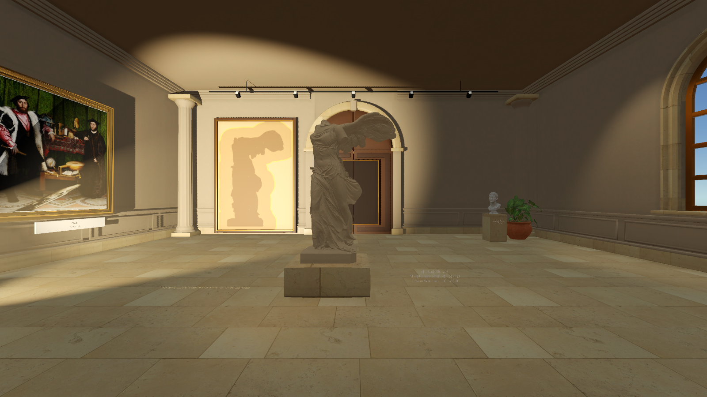
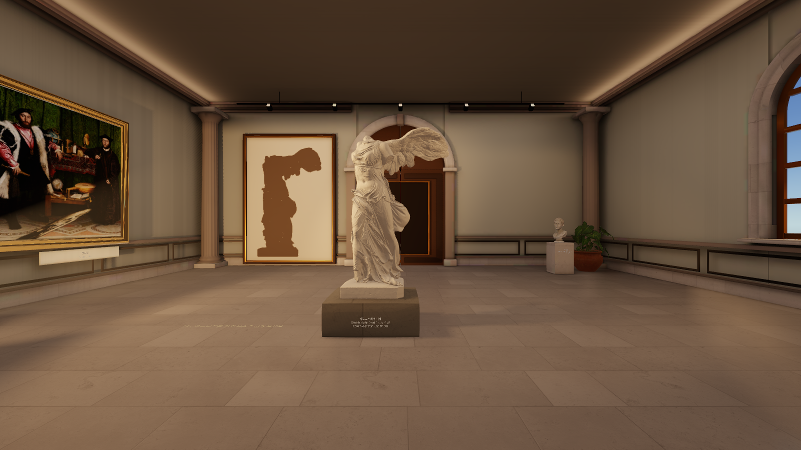
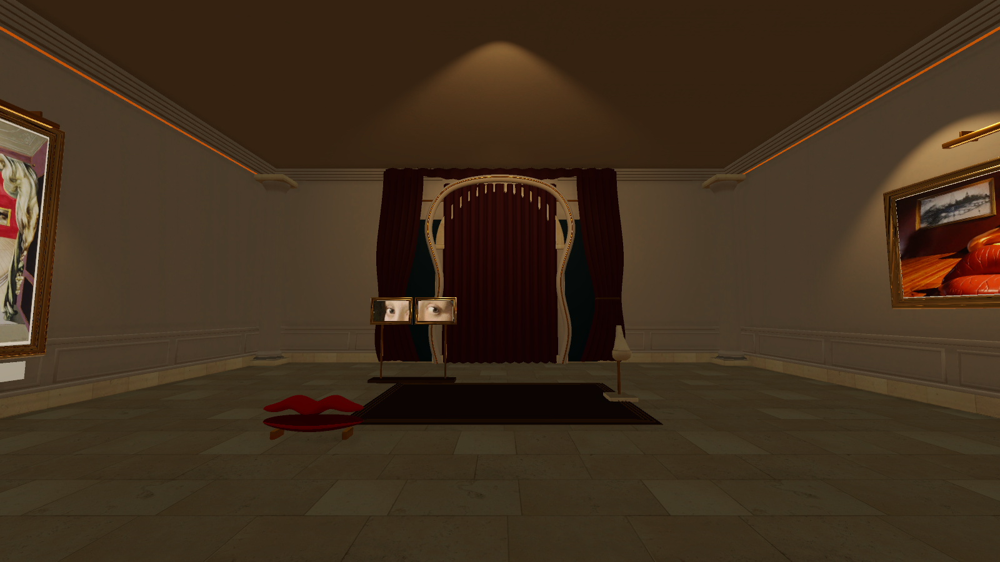
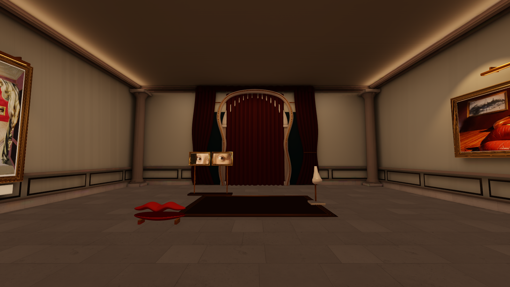
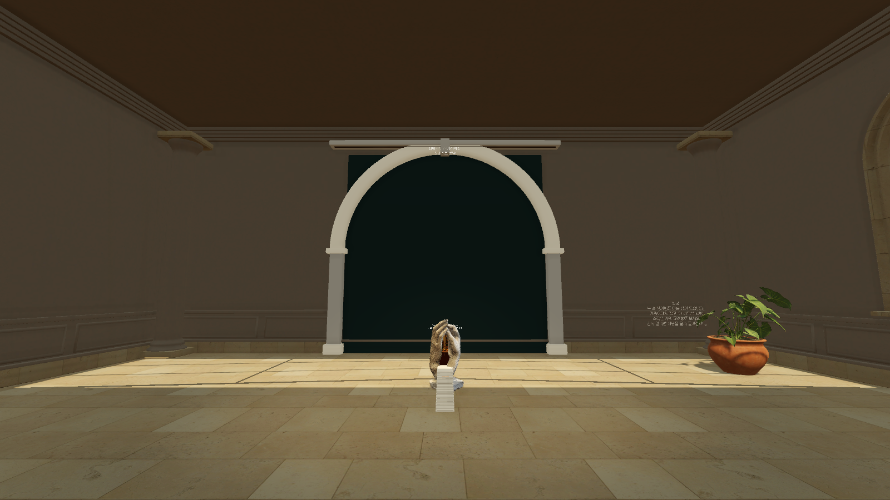
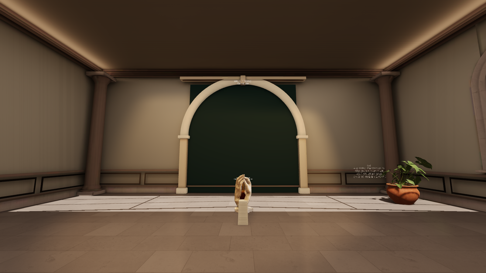

# 미술관 조명·재질 개선 검토

명화 전시실부터 니케, 얼굴, 손문 방까지 따뜻한 간접광과 선명한 석재 질감으로 맞췄다. 바닥은 방의 실제 렌더 결과를 반사하고, 조각상과 문은 움직일 때 현재 모양에 맞는 그림자를 사용한다.

## 실제 게임 화면 비교

조명 개편 전과 최종 버전을 동일한 카메라 위치·시선·시야각에서 촬영했다. 아래 여섯 사진은 Unity 플레이어가 저장한 원본을 그대로 복사했다. 생성 이미지나 별도 색 보정 결과가 아니다. 퍼즐 진행 전의 같은 상태를 비교하므로 손문 방의 조각상은 아직 작은 상태다.

| 공간 | 변경 전 | 변경 후 |
| --- | --- | --- |
| 니케 방 |  |  |
| 얼굴 방 |  |  |
| 손문 방 |  |  |

## 플레이어가 보는 변화

- **바닥 반사:** 각 방의 벽·작품·조명을 실제 HDR 큐브맵으로 담고, 방의 경계와 시선 방향에 맞춰 반사를 계산한다. 표면 거칠기에 따라 반사가 부드럽게 흐려지고 보는 각도에 따라 강도가 바뀐다. 석회암의 무늬와 미세한 요철은 남기되 얼룩 대비와 과한 노란 기를 줄였다.
- **방 전체의 간접광:** 천장 가장자리와 넓은 천장 반사광이 벽·몰딩·바닥에 퍼진다. 천장의 국소적인 밝은 얼룩을 줄이고, 작품에 비추는 빛과 배경 밝기를 나눴다.
- **재질 구분:** 벽, 천장, 장식 석재, 바닥을 따로 조절한다. 조각상은 크림색 석고로, 벽은 따뜻한 회갈색으로 보이도록 했다. 재질 프리셋이 지정한 색을 덮어쓰던 순서도 바로잡았다.
- **현재 모양을 따르는 그림자:** 방별 전시 조명에서 실제 메시의 깊이를 읽는다. 니케와 손 조각의 세부 윤곽, 기둥과 몰딩의 명암을 살리고, 움직이는 물체의 그림자는 현재 위치로 갱신한다.
- **선명도와 눈부심:** 톤 매핑과 화이트 밸런스를 조절하고, 블룸과 니케 빛줄기의 농도를 낮췄다. 텍스처의 비스듬한 시점과 모서리 품질도 높였다.
- **니케 안내:** 캔버스의 겹친 색 띠를 하나의 읽기 쉬운 실루엣으로 정리했다. 그림자 판정의 여유 범위는 유지한다. 작품 표기는 이동하는 받침대 앞면에 붙였다.

## 조명 계산과 반사의 범위

고정 건축물의 반사광은 미리 계산한 라이트맵을 사용한다. 움직이는 조각상은 라이트 프로브를 사용하고, 주울 수 있는 물체·여닫는 문·커튼은 고정 그림자 계산에서 제외한다. 문이 열린 뒤 닫힌 상태의 그림자가 남는 일을 피하기 위해서다.

바닥의 환경 반사는 시작 시 각 방에서 캡처한 장면을 사용한다. 움직이는 물체나 변화하는 연출을 매 프레임 다시 반사하는 거울·화면 공간 반사 방식은 아니다. 동적 전시 그림자는 현재 방을 중심으로 갱신하고 사용하지 않는 렌더 자원은 해제한다.

`Parallax > 미술관 Windows 빌드`는 씬 준비 뒤 반사광 계산을 실행한다. 고정 건축물이나 조명을 수정한 뒤에는 Gallery 씬에서 `Parallax > 미술관 반사광 굽기`를 실행해야 한다. 절차적으로 생성한 메시의 라이트맵 UV, 조명 설정, 라이트맵과 저장된 씬도 함께 포함한다.

## 검증

Unity **6000.3.24f1**, macOS / **Apple M4 Pro / Metal**의 실제 플레이어에서 확인했다.

| 확인 항목 | 결과와 근거 |
| --- | --- |
| macOS 실행 파일 | 최종 조명·재질을 포함한 빌드 성공 |
| 실제 카메라 촬영 | 최종 14개 시점 촬영 성공. 라이트맵 로딩, 계산용 광원의 런타임 비활성화, 전시 그림자 해제·재활성화, 지원하지 않는 재질 여부도 확인. [기록](after-capture.json) |
| 얼굴 방 연출 | 흡수·붉은 조명·미소·커튼 열림·초기화 확인. 바닥 2,736회 샘플에서 직사광·반사광 판정이 생기지 않았고 이동 중 노출과 리스폰이 없었다. [결과](portrait-performance-results.json) |
| 미술관 통합 진행 | 청동판 그늘, 니케와 액자 문, 얼굴 조립, 커튼 통과, 손 조각 확대·놓기·착지·계단 진입과 Library 전환 확인. [결과](museum-mechanics-results.json) |

통합 진행 검증의 청동판·니케 구간은 명시된 배치 fixture를 사용한다. 얼굴 조립과 손문 확대·놓기는 실제 상호작용 경로를 사용한다. 촬영 성공은 퍼즐을 독립적으로 해결했다는 뜻이나 이미지의 픽셀 일치 검증이 아니다. 각 검증의 상세 범위는 결과 JSON의 `scope`에 기록했다.

Windows/DX11 실행, 여러 GPU의 성능 비교와 프레임 시간 측정은 하지 않았다. 참고 시안과의 조형·구도·명암 차이는 남아 있다.
