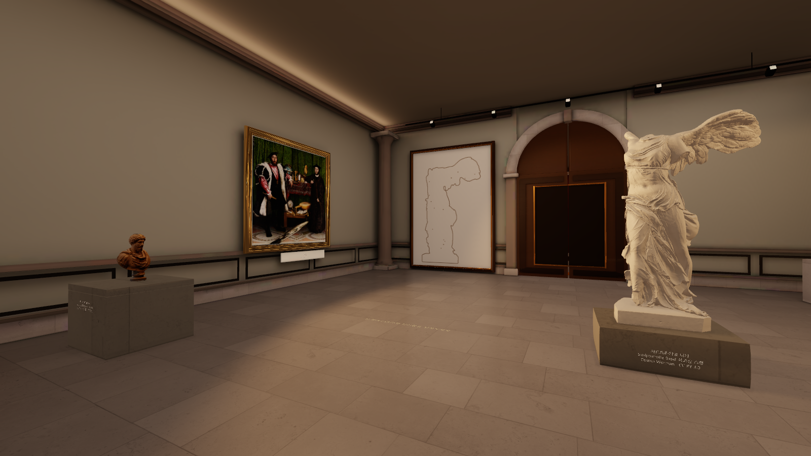
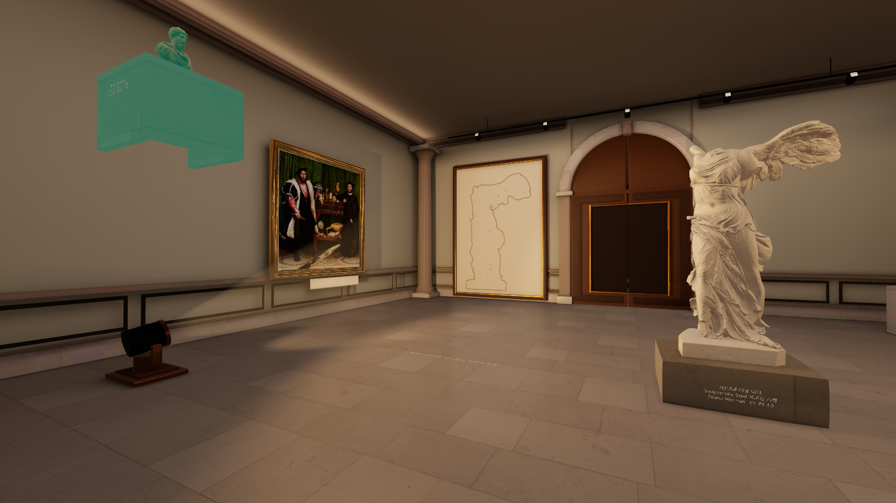
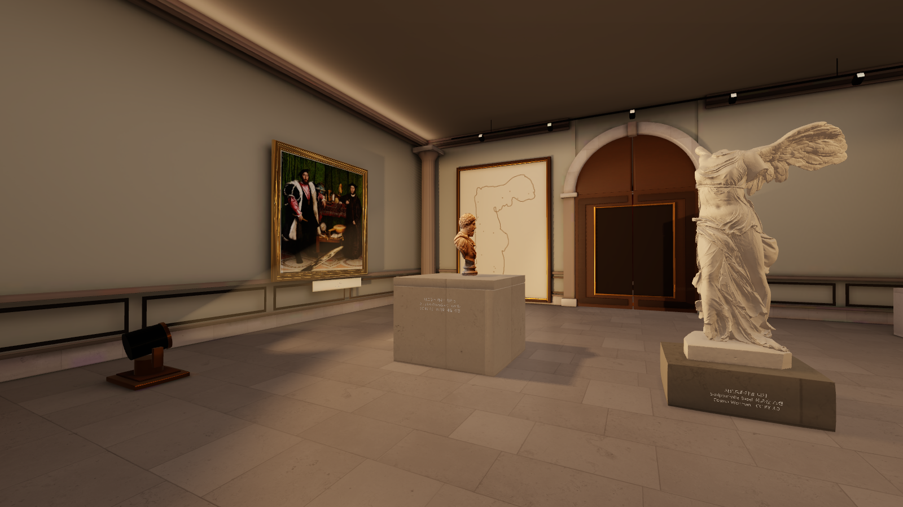

# 니케 퍼즐: 가려진 조명 발견

니케실의 고정 조명을 대리석 흉상과 속이 빈 받침으로 가린다. 플레이어가 전시물을 들어 올리면 밑의 조명을 발견하고, 니케의 그림자를 빈 캔버스의 윤곽에 맞춰 기존 붓질·액자·문 열기 연출로 진행한다.

- 흉상과 받침은 다른 전시물과 같은 집기·자유 이동·원근 크기 조절·놓기 흐름을 사용한다. 좌우 이동 제한은 없다.
- 조명 위치는 고정이다. 받침이 실제로 빛을 막는 동안에는 정답 배치라도 퍼즐이 완료되지 않는다.
- 니케 시작 위치를 오른쪽으로 1.5m 옮기고, 캔버스는 내부가 빈 윤곽선으로 바꿨다.
- 조명을 발견하기 전에는 주변 전시물을 살피도록 안내한다. R 초기화는 흉상·니케·가려진 조명·닫힌 문을 복원한다.
- 실제 아우렐리우스 스캔은 원본 246,073삼각형과 UV 텍스처를 유지했다. 제작자 ryanfb, CC BY 4.0이며 출처와 변경 내용은 [조각 크레딧](../../projects/all-stages/Documentation/Gallery/MuseumScan-Credits.md)에 기록했다.

## 실제 Windows 실행 화면

생성한 예상도가 아닌 동일 카메라의 플레이어 렌더다. 이미지는 원본 캡처를 그대로 복사했다.

조명이 가려진 시작 상태:



일반 집기로 들어 올린 상태:



다른 위치에 내려놓은 상태:



## 검증 결과와 범위

Unity 6000.3.24f1 / Windows / RTX 3070에서 빌드 성공, 오류 0개다. 경고 6개는 기존 `MuseumSurface` D3D11 셰이더의 반복문 내 gradient 경고다.

- 발견 검증 968틱: 실제 카메라 집기·들어 올리기·3차원 운반·원근 축척·놓기·PhysX 안착, 가림 중 완료 차단, 고정 광원, 붓질·액자·문 열기, 초기화 통과. 발견 검증 중 리스폰 0회.
- 기존 진행 검증 5,267틱: 미술관 이동, 초상화 커튼, 성당 조각과 실제 Library 씬 진입 통과.
- 실제 카메라 16뷰 캡처 통과. 기존 라이트맵 2개와 조명 데이터의 보존도 확인했다.

이 결과는 **PR21 조명을 통합한 canonical 로컬 체크아웃 `9af5380196f34a601a80f3c680d3d399ff5b9a62`에 니케 변경을 적용한 Windows 실행본**에서 얻었다. 새 PR은 `origin/main`을 기준으로 분리하므로, 깨끗한 PR 브랜치 단독 빌드 검증 결과로 해석하면 안 된다.

발견 검증의 흉상 양성 경로는 전시물의 위치·크기·강체·안착 상태를 직접 지정하지 않는다. 플레이어 접근 위치는 준비된 값이며, 니케 정답과 마지막 액자 소켓은 명시적인 수학적 배치 fixture를 사용한다. 전체 퍼즐을 입력만으로 자율 해결했다는 주장이나 GPU/CPU 픽셀 일치 검증은 아니다. 세부 범위와 원본 보고서는 [verification.json](verification.json)에 담았다.

검증 실행 명령:

```powershell
& "<Windows 플레이어 경로>/Parallax.exe" -batchmode -force-d3d11 -screen-fullscreen 0 -gallery-nike-discovery-test -validationDir "<절대 출력 경로>"
& "<Windows 플레이어 경로>/Parallax.exe" -batchmode -force-d3d11 -screen-fullscreen 0 -gallery-mechanics-test -validationDir "<절대 출력 경로>"
& "<Windows 플레이어 경로>/Parallax.exe" -batchmode -force-d3d11 -screen-fullscreen 0 -gallery-concept-capture -captureDir "<절대 출력 경로>"
```
