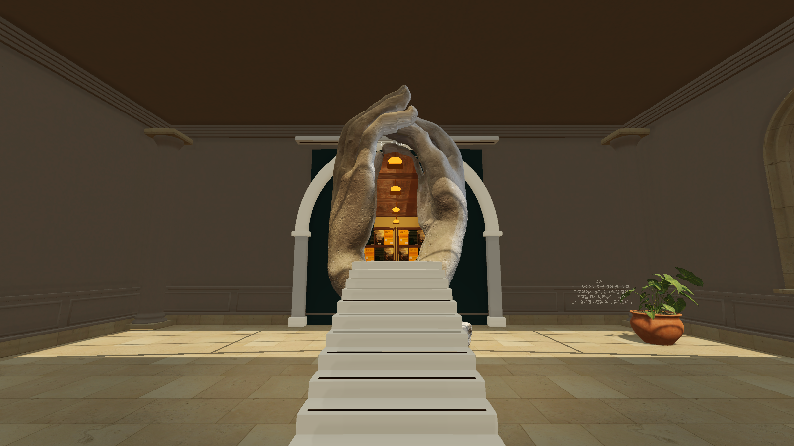
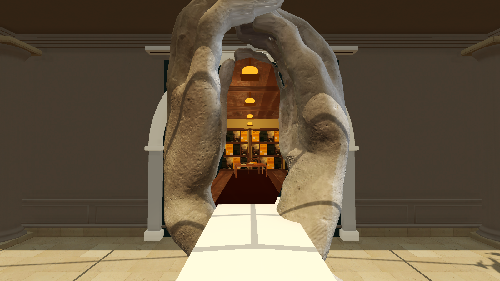
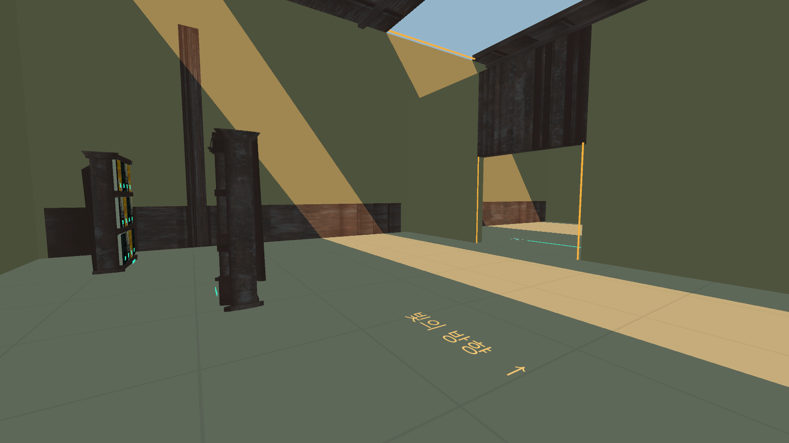

# 미술관 v0.20 검토·실행 안내

미술관의 전시 공간과 네 구역의 퍼즐을 새로 구성하고, 마지막 출구를 로댕의 **〈성당 — La Cathédrale〉 실물 스캔**으로 바꿉니다. 두 손 사이에서는 따뜻한 빛을 받는 도서관 풍경이 보이고, 조각을 확대해 통과하면 낙하 연출을 거쳐 실제 Library 스테이지로 이어집니다. 출구에 바람 소리는 사용하지 않습니다.

개발 기준은 `projects/all-stages`입니다. `projects/gallery`는 이전 단독판이므로 이번 검토에는 사용하지 않습니다.

## Windows에서 실행

1. PR의 브랜치를 체크아웃하거나 그 브랜치의 ZIP을 풉니다.
2. Unity Hub에서 **Unity 6000.3.24f1**과 **Windows Build Support (Mono)**를 설치합니다.
3. Unity Editor를 닫고 저장소 최상위의 **`미술관_실행.cmd`**를 더블클릭합니다.

첫 실행은 현재 소스를 별도 `Builds/StageProject`에 복사하고 미술관·도서관 씬을 재생성해 빌드하므로 시간이 걸립니다. 다음 실행부터는 소스 해시를 비교해 준비된 실행본을 사용합니다. 출력은 `Builds/Latest/Gallery/Parallax.exe`입니다.

Editor 위치를 자동으로 찾지 못하면 저장소 최상위에서 실행합니다.

```powershell
.\scripts\run-stage.ps1 -Stage Gallery -Rebuild -UnityEditor "C:\path\to\Editor\Unity.exe"
```

실행 중인 같은 Gallery 실행본이 있으면 먼저 종료합니다. 빌드 실패 시 `Builds/Latest/Gallery`의 로그를 확인합니다.

## Unity에서 검토

Unity Hub에 `projects/all-stages`를 추가하고 `Assets/Parallax/Gallery/Scenes/Gallery.unity`를 엽니다. 소스로 전시실을 다시 만들려면 **Parallax → 미술관 씬 준비**를 실행합니다. 직접 편집한 씬을 보존하려면 먼저 별도 이름으로 저장하세요.

Library 전환을 시험할 때는 Build Profiles의 Scene List에 다음 두 씬이 활성화되어 있어야 합니다.

- `Assets/Parallax/Gallery/Scenes/Gallery.unity`
- `Assets/Parallax/Library/Scenes/Library.unity`

## 플레이 흐름

| 구역 | 확인할 동작 |
| --- | --- |
| 명화 전시실 | 이젤의 복제작을 확대·배치하고 그 그림자로 햇빛 구간을 건넙니다. |
| 빛과 그림자 | 고정된 니케의 그늘과 이동식 전시 패널 두 개로 그늘 길을 잇습니다. |
| 시점의 방 | 눈 액자·코 조각·입술 소파를 한 얼굴로 맞추고, 원형 관람 지점에서 2초 바라보면 커튼이 열립니다. |
| 로댕의 성당 | 손 사이의 다른 공간을 발견하고, 조각을 확대·안착시킨 뒤 틈으로 걸어 들어가 Library로 이동합니다. |

앞의 두 전시실에는 빛 노출 위험이 있습니다. 시점의 방과 출구에서는 안전하게 조작할 수 있습니다. 메뉴의 구역 체험 버튼으로 특정 기믹부터 확인할 수도 있습니다.

## 조작

| 입력 | 동작 |
| --- | --- |
| WASD / 마우스 / Space | 이동 / 시점 / 점프 |
| 왼쪽 클릭 | 사물 잡기·놓기 |
| 오른쪽 버튼 + 마우스, Q/E | 사물 회전 |
| Z/X, C | 기울기 조정 / 바로 세우기 |
| Backspace | 잡기 취소 |
| H | 현재 구역 힌트 |
| R / Shift+R | 현재 구역 / 처음부터 초기화 |
| Esc | 메뉴 |

크기는 전용 확대 버튼으로 바꾸지 않습니다. 사물을 잡은 뒤 위치를 옮기고 시선이 닿는 표면의 거리를 바꾸는 원근 조작을 사용합니다. 내려놓고 안정된 사물의 그림자가 보호 기능을 가집니다.

## 실제 화면과 검증 기록

아래는 v0.20 Windows 실행본의 실제 카메라 화면입니다. 출구 정면·근접 이미지는 구도와 크기를 지정한 시각 검토 배치이며, 도서관 도착은 실제 조작·충돌·씬 전환 검사 중 촬영했습니다.







- Windows 빌드: 성공, 빌드 오류 0 / 경고 0. Unity 6000.3.24f1. 별도 체크아웃에서 Unity 캐시 없이 빌드하고 포털·네 구역 통합 검사를 다시 통과했습니다.
- 공통 사물 조작·조작감·물리 정책 105개 검사와 전시물 9개의 초기 배치 검사 통과.
- 손 열림 시 벽과 겹치는 배치를 거부하고, 탐색 후 collider와 작품 위치가 복구되는 검사 통과.
- 실제 도서관 렌더, 좌우 시점에 따른 원근 변화, 미술관 뒷배경 가림, 무음, 포털 비활성화·재활성화 검사 통과.
- 네 전시실 통합 검사 3,644틱 통과. 실제 입력으로 초상을 맞추고, 조각을 확대·해제·안착시킨 뒤 controller로 계단과 입구를 통과했습니다. 10m 이상의 낙하 후 Library를 한 번 로드하고 조작을 재개했습니다.

그림자 구역은 명시적인 정답 배치를 준비한 뒤 실제 controller로 이동한 검사입니다. 초상과 출구의 조작 검사에도 시작·접근 위치 배치가 포함됩니다. 무보조 전체 퍼즐 공략으로 설명하지 않습니다. 요약 데이터는 [validation-summary.json](museum-v0.20/validation-summary.json)에 있습니다.

## 외부 작품과 사용 조건

| 자산 | 제작·배포 | 조건 |
| --- | --- | --- |
| 〈성당〉 스캔 | Migg, 파리 로댕박물관 전시물을 RealityScan으로 촬영 | [CC BY 4.0](https://creativecommons.org/licenses/by/4.0/), [원 배포](https://sketchfab.com/3d-models/la-cathedrale-d0ba1f143173484f87961fc50d46bdcf), [공개 보존본](https://zenodo.org/records/10364942). 게임용 정리·좌표 변환·크기 조정 사항을 크레딧에 표시합니다. |
| 사모트라케의 니케 스캔 | Cosmo Wenman, Skulpturhalle Basel 석고 캐스트 | [CC BY 3.0](https://creativecommons.org/licenses/by/3.0/), [제작자 설명](https://cosmowenman.com/2013/12/28/winged-victory-published-update-12282013/). 루브르 원작을 직접 스캔한 데이터로 소개하지 않습니다. |
| 흉상·화분·표면 텍스처 | Poly Haven | [CC0](https://polyhaven.com/license). |
| 명화 이미지 | Wikimedia Commons의 각 작품 자료 | 작품별 공개 영역·출처는 `Documentation/Gallery/MuseumArt-Credits.md`에 보존합니다. |
| 포털 안의 도서관 가구·책 | 기존 도서관의 Rinku Choudhary / Medieval Library Kit | Free Standard (NoAI). CC BY 에셋으로 표기하지 않습니다. `Documentation/ThirdParty/Library-Asset-Integration.json`의 기존 출처 기록을 따릅니다. |

세부 출처와 변경 사항은 `projects/all-stages/Documentation/Gallery/MuseumScan-Credits.md`, `MuseumArt-Credits.md`, `MuseumMaterial-Credits.md` 및 실행본의 `Museum-Credits.txt`를 확인합니다. 원본 스캔을 단순 도형으로 대체한 모델로 설명하지 않습니다.

## PR용 자산 목록

최종 씬을 저장한 뒤 `ShadeLink.Editor.GalleryReviewManifest.Save`를 실행하면 `Validation/Gallery/review-manifest.json`에 필요한 Gallery 파일, 씬 의존 자산, 파일 크기와 SHA-256을 기록합니다. `-gallery-review-output <경로>`로 출력 위치를 지정할 수 있습니다.

다른 검토용 checkout으로 옮길 때는 다음처럼 먼저 복사 계획을 확인합니다.

```powershell
.\scripts\prepare-museum-review.ps1 -SourceProject "C:\source\projects\all-stages" -ManifestPath "C:\source\projects\all-stages\Validation\Gallery\review-manifest.json" -WhatIf
```

이 도구는 manifest에 기록된 Gallery 파일의 해시를 먼저 확인하고, 미술관 소스·리소스·현재 씬의 Generated 의존 자산을 복사합니다. 저장소의 빌드 실행본과 Unity 캐시는 소스 PR에 포함하지 않습니다.
