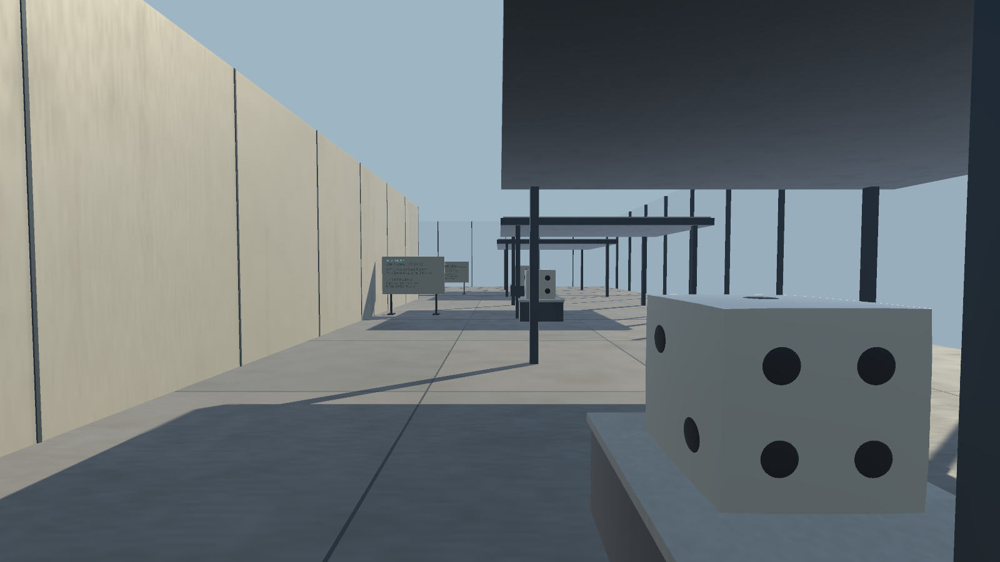
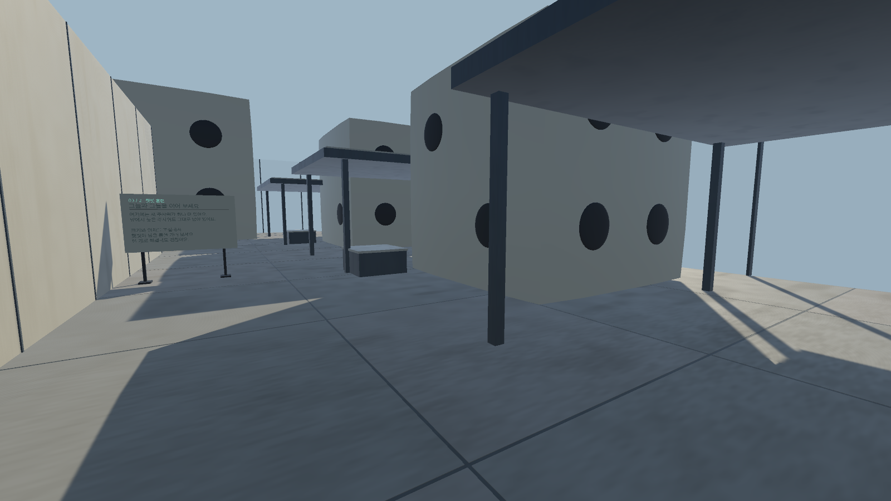
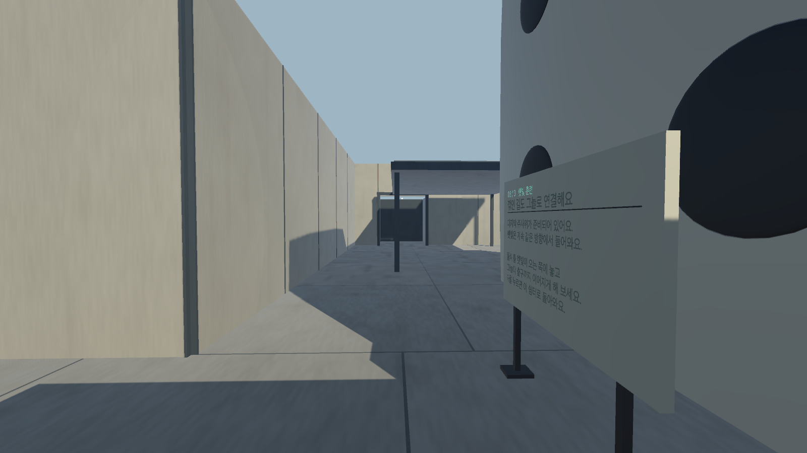

# 튜토리얼 3스테이지: 햇빛과 그늘

2스테이지의 높은 문을 나가면 같은 높이의 ㄱ자 채광실로 이어진다. 주사위를 원근 조작으로 키워 내려놓고, 그늘을 연결해 출구까지 이동하는 플레이 가능한 초안이다.

## 진행

- 입구 쉼터에서 첫 주사위로 햇빛 구간을 가리는 방법을 익힌다.
- 첫 쉼터에 도착하면 다음 주사위를 활용해 그늘의 틈을 메운다. 앞에 둔 물체는 그대로 남는다.
- 모퉁이에서는 마지막 주사위로 꺾인 길을 가려 출구까지 이동한다. 주사위 세 개를 모두 쓰도록 강제하지 않는다.
- 햇빛에 약 1초 이상 계속 노출되면 마지막 쉼터로 돌아온다. 그늘에서는 노출이 빠르게 줄고, 놓아 둔 주사위 배치는 유지한다. 화면 가장자리와 짧은 소리로 노출을 알린다.
- `R`은 마지막 쉼터로 복귀한다. `ESC`의 처음부터 다시 시작과 1·2·3스테이지 바로가기는 해당 연습 상태를 초기화한다.
- 2스테이지 문을 자연스럽게 통과할 때는 보던 방향을 유지한다. 바로가기를 사용할 때는 각 스테이지의 시작 시점으로 맞춘다.

태양 방향은 고정되어 있다. 놓인 주사위와 지붕의 실제 충돌 형상을 향해 햇빛 방향으로 검사하고, 들고 있는 물체는 차광 판정에서 제외한다. 햇빛 쪽 벽은 유리와 가느다란 프레임으로 구성해 벽 뒤의 긴 고정 그늘만 따라 우회하는 것을 줄였다.

## 함께 포함된 튜토리얼 변경

main에 아직 반영되지 않았던 현재 튜토리얼 조정을 함께 포함한다.

- 1스테이지 시작 시점을 중앙으로 되돌리고 탁자·안내판을 조정했다.
- 2스테이지의 1.8m·3.6m 주사위를 천장 아래에 미리 두고, 회전과 앞뒤 위치를 달리해 차례로 떨어뜨린다. 첫 착지 뒤 약 0.2초 후 다음 낙하를 시작한다.
- 착지 화면 진동은 최대 1.45°로 제한하고 크기에 따라 강도가 커진다. 렌더링 시야만 움직이며, 약한 접촉과 반복 튕김은 생략한다.
- ESC에 전체 재시작과 스테이지 바로가기를 제공한다. 전환할 때 잡기·낙하·진동·조명 상태를 정리한다.

## 실제 게임 캡처

Unity Play Mode에서 실제 Tutorial 카메라로 저장한 1600×900 원본이다. 생성 이미지, 합성이나 별도 색 보정을 사용하지 않았다. 카메라 출력이므로 HUD는 포함하지 않는다. 두 번째·세 번째 사진은 아래 검증에 명시한 주사위 예시 배치를 사용한다.

### 입구와 쉼터



### 원근으로 키운 주사위와 그늘길



### ㄱ자로 꺾이는 마지막 구간



## 실행과 검증

Unity **6000.3.24f1**에서 `projects/all-stages/Assets/Parallax/Tutorial/Scenes/Tutorial.unity`를 연다. 2스테이지 출구를 통과하거나 ESC에서 **3스테이지 · 햇빛과 그늘**을 선택한다. 실행 파일은 `--tutorial-stage3` 인자로 해당 구간에서 시작할 수 있다.

필수 검증과 macOS 빌드:

```text
Unity -batchmode -projectPath <projects/all-stages 절대 경로> -buildTarget StandaloneOSX -executeMethod ShadeLink.Editor.TutorialSunlightDraftChecks.Build -tutorialCaptureDir <캡처 저장 절대 경로> -logFile <로그>
```

이 검사는 Play Mode로 전환한 뒤 종료되므로 `-quit`을 붙이지 않는다. 그림자 캡처에는 그래픽 장치가 필요하다. 기본 출력은 `builds/macos/all-stages/Parallax-Tutorial-Sunlight-Draft.app`이다.

- 착지 피드백 단위 검사, 실제 충돌·낙하·일시정지·스테이지 메뉴 전환 검사 통과.
- 고정 쉼터의 차광과 구간 사이 햇빛 노출 확인.
- 세 주사위 예시 배치에서 0.2m 간격으로 동선의 차광과 캐릭터 충돌 여유 확인.
- 체크포인트 저장, 복귀 때 배치 유지, 출구 완료, 2→3 자연스러운 연결과 1스테이지 복귀 상태 확인.
- macOS 빌드 성공, 오류 0. [검증 기록](verification.json)

검증은 정해진 예시 배치를 사용한 장면 검사이며, 마우스와 키보드만으로 퍼즐 전체를 풀었다는 의미는 아니다. Windows 실행과 ESC의 모든 버튼을 실제로 클릭하는 경로는 이번에 완전히 확인하지 않았다. 최종 미술과 난이도는 플레이 피드백에 따라 추가 조정할 초안이다.
